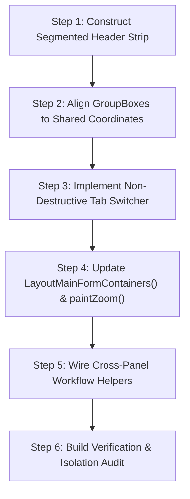

# Architectural Audit & Implementation Plan: Three-Tab Left Panel System for GTL Editor

## Executive Summary
In the current GTL Editor interface (.NET 9.0 Windows Forms, x64), the left column contains three group boxes stacked vertically within a `390px`-wide column:
1. **Tile Working Area** (`groupBox3`): `390 × 156 px`
2. **Text Working Area** (`groupBox1`): `390 × 536 px`
3. **Stored Position Area** (`groupBox4`): `376 × 222 px`

Stacked end-to-end, these panels require a minimum of `156 + 8 + 536 + 8 + 222 = 930 px` of vertical space. On standard `1366 × 768` laptop displays—where available client vertical space between the toolbar and status bar is approximately `570–610 px`—this stacked arrangement leads to severe vertical crowding:
- `Stored Position Area` (`groupBox4`) is pushed almost entirely off-screen or clipped behind the Windows taskbar.
- The 360° rotation cross, slider, and angle text box at the bottom of `Text Working Area` (`groupBox1`) are crowded or partially obscured.

This plan details a **Three-Tab System** positioned at the top of the left area (`X = 7`, `Width = 390`) that displays **only one complete panel at a time**. This gives each panel full vertical breathing room while preserving 100% of control state, cross-panel bindings, and binary format invariants.

---

## 1. Current Panel Hierarchy & Control Inventory

### A. Tile Working Area (`groupBox3`)
* **Parent:** `Form1` (direct child in `this.Controls`)
* **Bounds:** `Location = (7, 50)`, `Size = (390, 156)`
* **Controls Contained:**
  * Dimensions: `txtWidth` (`52 × 26`), `label1` (`"x"`), `txtHeight` (`52 × 26`)
  * Buttons: `btnStretch` (`Stretch`), `btnResize` (`Resize`), `btnCorners` (`Clip`), `btnGradient` (`Bevel`), `btnClear` (`Clear`)
  * Dropdowns: `cboCornerSize` (Clip radius), `cboBorderSize` (Bevel width), `cboClear` (Clear target)
  * Transparency: `pctTransparentColor` (`30 × 26` mask preview), `label2` (`"Transparent Color"`)
* **Layout Method:** Managed by `LayoutTileWorkingArea()` in `Read_GTL/GTL Text Editor.cs` (lines 956–1035).

### B. Text Working Area (`groupBox1`)
* **Parent:** `Form1` (direct child in `this.Controls`)
* **Bounds:** `Location = (7, 214)`, `Size = (390, 536)`
* **Controls Contained:**
  * Reset & Alignment: `btnReset` (`84 × 32`), `btnAlignLeft`, `btnAlignCenter`, `btnAlignRights` (`32 × 32` each)
  * Vertical Nudge Stack: `btnExtendRange` (`+`), `btnAlignTop` (`T`), `btnAlignMiddle` (`-`), `btnAlignBottom` (`_`), `btnReduceRange` (`-`)
  * Coordinate & Text Controls: `vScrollText` (`24 × 170`), `txtText` (text input), `lblTileSize` (tile dimensions), `lblTextPlacement` (X,Y placement coordinates), `hScrollText` (`hScrollBar`)
  * Action Buttons: `btnHideControls` (`Hide`), `btnPlace` (`Place`), `btnStore` (`Store`), `btnReplace` (`Replace`)
  * Increment Checkbox: `chkIncrement` (`#d increment`)
  * 360° Rotation Cluster: `btnRotate0` (`0°`), `btnRotate90` (`90°`), `btnRotate180` (`180°`), `btnRotateminus90` (`270°`), `pctRotate` (`80 × 80` preview), `txtRotate` (`50 × 28` angle box), `hScrollRotate` (`hScrollBar`)
* **Layout Method:** Managed by `LayoutTextWorkingArea()` and `LayoutRotationControls()` in `Read_GTL/GTL Text Editor.cs`.

### C. Stored Position Area (`groupBox4`)
* **Parent:** `Form1` (direct child in `this.Controls`)
* **Bounds in Designer:** `Location = (7, 523)`, `Size = (376, 222)`, `Anchor = Top | Bottom | Left`
* **Controls Contained:**
  * `panel2`: Outer scroll viewport (`368 × 198`) containing `panel3`
  * `panel3`: Inner dynamic container hosting individual `positionTextDisplay` user controls
  * `vScrollBar2`: Vertical scrollbar docked right (`DockStyle.Right`)
* **Management:** Managed via `positionDisplay` class in `Read_GTL/Form1.PositionDisplay.cs`.

---

## 2. Critical Cross-Panel Runtime Invariants

### ⚠️ Gotcha #1: Hardcoded String Indexing `HostForm.Controls["groupBox..."]`
A critical architectural dependency exists in `Read_GTL/Form1.PositionDisplay.cs` and `Read_GTL/Form1.TileDisplay.cs`:
```csharp
// Form1.PositionDisplay.cs (Lines 247-270):
((Button)HostForm.Controls["groupBox1"].Controls["btnReplace"]).Text = "Replace " + ((Button)sender).Tag.ToString();
((TextBox)HostForm.Controls["groupBox1"].Controls["txtText"]).Text = workingPosition.txtPositionText.Text;
((ScrollBar)HostForm.Controls["groupBox1"].Controls["hScrollText"]).Value = workingPosition.PointPlacement.X;

// Form1.TileDisplay.cs (Lines 448-471):
((PictureBox)HostForm.Controls["pctzoom"]).Top = ((GroupBox)HostForm.Controls["groupBox4"]).Bottom - ((PictureBox)HostForm.Controls["pctzoom"]).Height;
((GroupBox)HostForm.Controls["groupBox1"]).Enabled = true;
((GroupBox)HostForm.Controls["groupBox3"]).Enabled = true;
((GroupBox)HostForm.Controls["groupBox4"]).Enabled = true;
```
* **Impact:** In Windows Forms, `ControlCollection.Item[string key]` only searches the **direct child controls** of the container. 
* **Rule:** `groupBox1`, `groupBox3`, and `groupBox4` **must remain direct children of `Form1`** (`this.Controls`). Re-parenting them inside a native WinForms `TabControl` / `TabPage` would cause `HostForm.Controls["groupBox1"]` to return `null` and immediately crash the application with `NullReferenceException`.

### ⚠️ Gotcha #2: `pctZoom` Vertical Alignment (`pctZoom.Top`)
In `Read_GTL/GTL Text Editor.cs` at line 5546 and `Read_GTL/Form1.TileDisplay.cs` at line 451:
```csharp
pctZoom.Top = groupBox4.Bottom - pctZoom.Height;
pctZoom.Left = groupBox2.Right - pctZoom.Width;
```
* **Impact:** `pctZoom` anchors its vertical position relative to `groupBox4.Bottom`. 
* **Rule:** `groupBox4` must have its `Bottom` extent aligned with the bottom of the left column content area, or `pctZoom.Top` must anchor to the shared left content bottom so the zoom preview remains anchored above the status strip regardless of which tab is active.

### ⚠️ Gotcha #3: Hardcoded Stacking in `LayoutMainFormContainers()`
In `Read_GTL/GTL Text Editor.cs` (lines 1230–1246):
```csharp
groupBox3.Top = flushTop;
if (groupBox1 != null) {
    groupBox1.Location = new Point(groupBox3.Left, groupBox3.Bottom + 8);
    groupBox1.Width = groupBox3.Width;
}
```
* **Rule:** `LayoutMainFormContainers()` must be updated so all three panels share the same top position below the tab header, rather than forcing `groupBox1` below `groupBox3`.

---

## 3. Recommended Three-Tab Switcher Architecture

### Native `TabControl` vs. Segmented Header Strip
| Architecture Criteria | Native WinForms `TabControl` | Segmented Header Strip + Visibility Switcher (Recommended) |
| :--- | :--- | :--- |
| **Direct Parent Integrity** | ❌ Re-parents into `TabPage` (breaks `HostForm.Controls["groupBox1"]`) | ✅ Preserves `Form1` direct parenting for all group boxes |
| **File Isolation (`AGENT.md`)** | ❌ Requires touching multiple files to rewrite control lookups | ✅ Purely contained within UI layer of `GTL Text Editor.cs` |
| **DPI & Theming Consistency** | ❌ Classic WinForms tab borders, background clipping, font scaling quirks | ✅ Clean, modern segmented flat tabs matching existing app aesthetics |
| **State Preservation** | ⚠️ Can trigger premature control reload or tab focus jumps | ✅ 100% state preserved; invisible controls retain memory, text, and handles |

### Geometry & Sizing Specification
* **Tab Header Bar (`panelLeftTabs`):**
  * `Location = Point(7, flushTop)` (where `flushTop = toolStrip1.Bottom + 1`)
  * `Size = Size(390, 32)`
  * Contains 3 flat segmented buttons:
    1. **Tab 1:** `btnTabTile` (`"Tile Tools"` / `"Tile"`, width ~`126px`)
    2. **Tab 2:** `btnTabTileText` (`"Text Tools"` / `"Text"`, width ~`126px`)
    3. **Tab 3:** `btnTabPositions` (`"Stored Positions"` / `"Positions"`, width ~`138px`)
* **Shared Panel Content Area:**
  * `Top = panelLeftTabs.Bottom + 4`
  * `Left = 7`
  * `Width = 390`
  * `Height = statusStrip1.Top - Top - 6` (dynamically fills full height down to status bar)

### Vertical Space on `1366 × 768` Displays
* Total available vertical client space: ~`570 px`
* **Tab 1: Tile Working Area (`groupBox3`):**
  * Requires `156 px`. Sits cleanly at `Top = panelLeftTabs.Bottom + 4` with `390px` width.
* **Tab 2: Text Working Area (`groupBox1`):**
  * Requires `536 px`. Fits completely within the ~`570 px` height with zero clipping. All buttons, coordinates, and 360° rotation controls are fully visible simultaneously.
* **Tab 3: Stored Position Area (`groupBox4`):**
  * Expands to `Height = statusStrip1.Top - Top - 6` (~`570 px`), allowing dozens of stored positions to be viewed comfortably in `panel2` / `panel3` with `vScrollBar2`.

---

## 4. State Preservation & Tab Switching Flow

### A. Non-Destructive Visibility Switching
Switching tabs executes a clean state switch without destroying or recreating controls:
```csharp
private enum LeftPanelTab { Tile, Text, StoredPositions }
private LeftPanelTab currentLeftTab = LeftPanelTab.Text;

private void SelectLeftTab(LeftPanelTab tab)
{
    currentLeftTab = tab;

    // Toggle panel visibility while maintaining direct Form1 child hierarchy
    groupBox3.Visible = (tab == LeftPanelTab.Tile);
    groupBox1.Visible = (tab == LeftPanelTab.Text);
    groupBox4.Visible = (tab == LeftPanelTab.StoredPositions);

    if (groupBox3.Visible) groupBox3.BringToFront();
    if (groupBox1.Visible) groupBox1.BringToFront();
    if (groupBox4.Visible) groupBox4.BringToFront();

    // Update active tab button visual styling
    UpdateTabButtonStyles();
}
```

### B. Seamless Workflow Interactions
1. **`btnStore_Click` (Storing a Text Position):**
   * Adds the position to `PositionDisplay`.
   * Stored position list in `groupBox4` updates in the background.
   * Dynamic Badge: Tab header automatically updates text to `"Stored Positions (N)"` to give immediate visual feedback without forcing a disruptive view switch.
2. **`btnRestore_Click` (Restoring a Stored Position):**
   * Restores font, color, coordinates, rotation, and text to `groupBox1`.
   * Automatically switches the tab switcher to `LeftPanelTab.Text` so the user immediately sees the restored text placed on the active canvas ready for editing/stamping.
3. **`btnSelect_Click` (Selecting a Position for Replacement):**
   * Updates `btnReplace.Text = "Replace N"` on `groupBox1`.
   * Automatically activates `LeftPanelTab.Text`.

---

## 5. Step-by-Step Implementation Roadmap



### Step 1: Construct Segmented Header Strip in `Form1`
* Create `panelLeftTabs` as a `390 × 32 px` container at `Point(7, toolStrip1.Bottom + 1)`.
* Add three flat `Button` controls (`btnTabTile`, `btnTabTileText`, `btnTabPositions`) with active/inactive high-contrast border and background rendering.

### Step 2: Align GroupBoxes to Shared Coordinates
* Set all three group boxes to share:
  * `Left = 7`
  * `Width = 390`
  * `Top = panelLeftTabs.Bottom + 4`
* Set `groupBox4.Height = statusStrip1.Top - groupBox4.Top - 6`.

### Step 3: Implement Non-Destructive Tab Switcher
* Implement `SelectLeftTab(LeftPanelTab tab)` to toggle `Visible` and `BringToFront()`.
* Default initial tab: `LeftPanelTab.Text` (primary working panel).

### Step 4: Update Layout Methods & Anchors
* In `LayoutMainFormContainers()`:
  * Position `panelLeftTabs` below `toolStrip1`.
  * Position `groupBox3`, `groupBox1`, `groupBox4` at `(7, panelLeftTabs.Bottom + 4)`.
  * Ensure `pctZoom.Top` anchors cleanly to the shared bottom.

### Step 5: Wire Cross-Panel Workflow Helpers
* In `Form1.PositionDisplay.cs:ClickbtnRestore`: after restoring controls, invoke tab switch to `LeftPanelTab.Text`.
* In `Form1.PositionDisplay.cs:ClickbtnSelect`: after setting `btnReplace`, invoke tab switch to `LeftPanelTab.Text`.
* Update `btnTabPositions.Text = PositionDisplay.Count > 0 ? $"Positions ({PositionDisplay.Count})" : "Positions"`.

### Step 6: Verification & Guardrail Audit
* Verify build with `dotnet build "GTL Editor.sln" -c Release` (`0 Warning(s)`, `0 Error(s)`).
* Verify on simulated `1366 × 768` resolution that all panels show full content without clipping.
* Confirm `Read_GTL/GTL_File.cs`, `PositionDataDto`, and `gtlTileDisplay` remain **100% untouched**.
